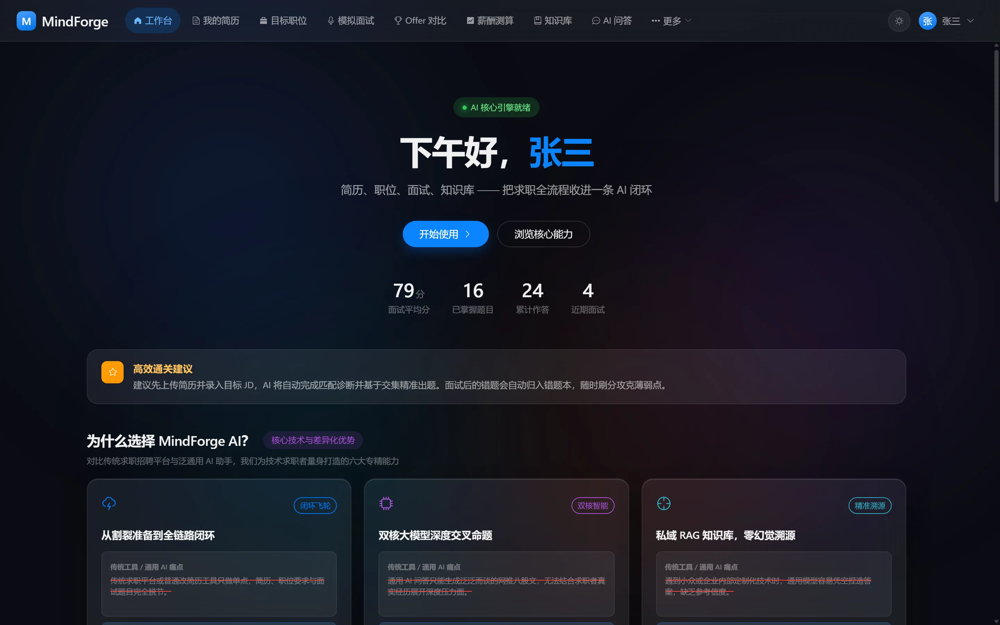
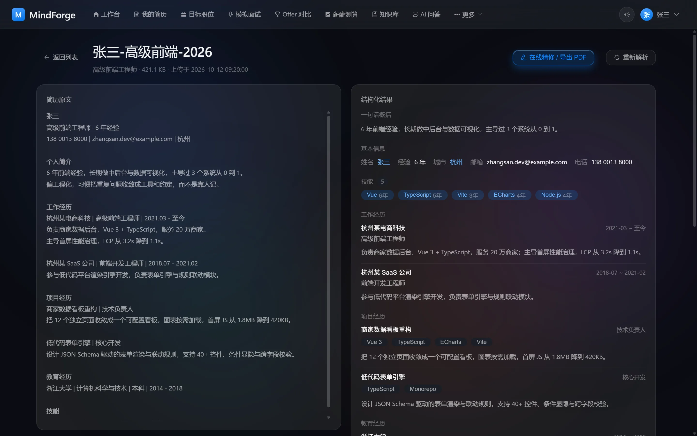
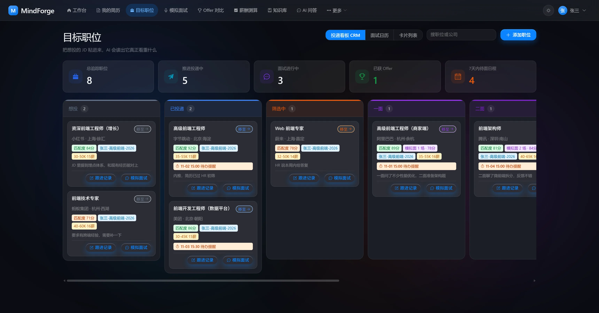
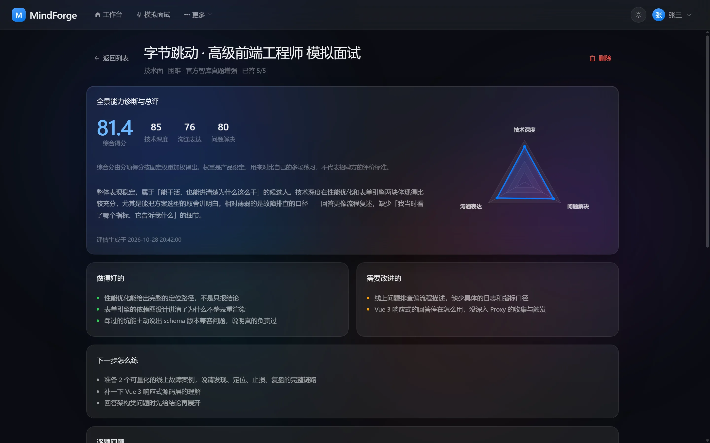

# MindForge Web

> 求职路上的一个工作台：简历、投递、面试、Offer 在同一处推进。

<p align="center">
  
  
  
  
  
  
</p>



## 这是什么

找工作这件事，信息天然是散的：简历在本地文件夹，投递记录在表格里，面试邀约在邮件和聊天记录里，
Offer 的条件靠脑子比。真正麻烦的不是某一件事难做，而是**同一件事的状态散在五六个地方**，
于是记不清投了哪家、面到第几轮、当时答应了多少。

MindForge AI 把这些环节收进一个工作台，让每一步的产出都成为下一步的输入：简历解析出来的
技能会参与后续岗位匹配，面试复盘里标出的薄弱点会回到待练列表，Offer 对比用的是之前录入的
真实条件，而不是回忆。

这个仓库是它的前端，同时维护两端：

| 包                | 面向       | 端口   | 路由 base |
| :---------------- | :--------- | :----- | :-------- |
| `apps/user`       | 求职者     | `5173` | `/`       |
| `apps/admin`      | 运营与运维 | `5174` | `/admin/` |
| `packages/shared` | 两端共用   | —      | —         |

一仓两端是因为两个端打同一套 API。请求客户端、Token 刷新、类型契约、权限码、设计 token
都只有一份实现，改一处两端同时生效——这类东西写两遍必然漂移。

## 核心能力

### 整理自己

上传 PDF 或 DOCX 简历，解析成结构化字段：基本信息、教育、工作经历、项目、技能。
原文和抽取结果左右对照，点右侧任意字段，左侧原文对应位置高亮——**能一眼看出模型是照抄还是瞎编**。

在线精修后导出 PDF，走服务端渲染而不是浏览器打印，避免分页错位与字体缺失。
另附 ATS 关键词评分，按目标岗位给出改写建议。



### 盯住机会

投递看板按阶段自动归类，每张卡片带匹配度、关联简历、待办提醒和备注。

HR 发来的面试邀约往往是聊天记录里的一段话——粘贴进来（或直接传附件），抽取出时间、地点、
轮次、联系人，确认后写入日历。抽取结果要求**能在原文中找到对应片段**，找不到依据的字段
直接丢弃：少填一项用户会补，填错一项用户通常不会逐条核对。



### 练到会答

模拟面试结合简历与目标岗位出题，支持多轮追问，结束后生成复盘报告：能力雷达图、
做得好 / 需改进 / 下一步怎么练三块，以及可以带走的回答素材。

薄弱点自动归档到错题本，可以单独重练——这是把「复盘」真正闭环的一步，
否则报告看完就搁置了。



### 做决定

多个 Offer 按薪资、技术栈、平台、加班强度、通勤距离五维加权排序，调整权重后排名实时更新。
权重是产品设定，用来横向对比自己的多个选择，不代表招聘方的评价标准——界面上也这么写。

薪酬测算按城市、岗位、年限、学历、技能给出年薪区间。置信度由服务端按规则下调
（城市不在常见表、岗位不命中关键词、年限越界），不采信模型自评。

### 随手查

个人知识库支持按语义检索与流式问答，回答附带引用来源；检索未命中时回退通用模型，
并在界面上明确标注「以下内容未来自你的知识库」。

### 管理端

面向运营与运维，与用户端共用同一套鉴权与权限模型：

- 全站指标与 Token 消耗趋势
- 用户、角色与权限矩阵（RBAC），权限码集中定义在 shared 里，两端共用
- 官方智库文档维护：批量上传、网页导入、切片预览、失败重试
- AI 配置：按用途（对话 / 向量化 / 重排）配置模型，展示当前实际生效的配置及其来源
- 用量统计、高危操作告警、全链路审计日志
- 设计规范页：设计 token 的可视化对照，深浅两套主题并排

## 快速开始

需要 Node.js 20+ 与 pnpm 12+：

```bash
corepack enable pnpm
pnpm install
```

启动前端之前需要先运行两个后端服务。它们是各自独立的仓库，需要单独克隆与启动：

| 服务           | 地址                        | 仓库                                                                                | 说明                            |
| :------------- | :-------------------------- | :---------------------------------------------------------------------------------- | :------------------------------ |
| Java 服务      | `http://localhost:8080/api` | [SunnyZest/mindforge-ai](https://github.com/SunnyZest/mindforge-ai)                 | 必需，提供全部业务接口          |
| Python AI 服务 | `http://localhost:8000`     | [SunnyZest/mindforge-ai-service](https://github.com/SunnyZest/mindforge-ai-service) | AI 功能需要；仅由 Java 服务访问 |

两个仓库各自的 README 里有详细的启动步骤与依赖说明。前端只依赖它们的 HTTP 接口，
不引用任何后端代码，因此可以分别升级。

只启 Java 服务时页面仍可正常浏览，但 AI 请求会返回服务不可用，管理端的 AI 配置页会显示
「读不到当前生效的配置」——两者是同一个原因。

```bash
pnpm dev         # 两端同时启动
pnpm dev:user    # http://localhost:5173/
pnpm dev:admin   # http://localhost:5174/admin/
```

`/api` 已代理至 `localhost:8080`，本地开发无需处理跨域。

```bash
pnpm typecheck   # vue-tsc 类型检查
pnpm lint        # ESLint
pnpm build:user  # 产物 → apps/user/dist
pnpm build:admin # 产物 → apps/admin/dist
```

## 技术选型

| 类别 | 技术                     | 版本     |
| :--- | :----------------------- | :------- |
| 框架 | Vue 3（组合式 API）      | `3.5.43` |
| 语言 | TypeScript               | `5.6.3`  |
| 构建 | Vite                     | `5.4.21` |
| 状态 | Pinia                    | `2.3.1`  |
| 路由 | Vue Router（History）    | `4.6.4`  |
| UI   | Element Plus（按需引入） | `2.14.7` |
| 图表 | ECharts（按需引入）      | `6.1.0`  |

版本刻意停在当前主流稳定档位而不是刚发布的大版本（Vite 5 而非 6、Pinia 2 而非 3），
生态与文档跟得上的版本更省事。`apps/*` 用 `^` 范围，仓库根的 lint 与构建工具用精确版本。

两个依赖做了按需引入，因为全量引入的代价很具体：ECharts 全量会给单个页面带来约 1.1 MB 的
chunk，改为 `echarts/core` 加 `echarts.use([...])` 后最大的图表页降到 400 KB 左右。

## 工程结构

```
apps/user/            用户端
apps/admin/           管理端，结构与用户端一致
  └── src/
      ├── api/        接口层，一个文件导出一个 xxxApi，方法名对齐后端 Controller
      ├── components/ 业务组件
      ├── composables/跨组件逻辑
      ├── layouts/    布局
      ├── router/     路由与菜单定义
      ├── stores/     Pinia
      └── views/      页面，一个路由一个 XxxView.vue

packages/shared/      两端共用，不做构建，由消费方 Vite 直接编译
  ├── src/            http / types / permission / auth / theme / format ...
  └── styles/         设计 token、主题、玻璃效果、Element Plus 覆盖
```

`packages/shared` 的 `main` 指向源码而非产物，省掉一层构建，改完立即生效。代价是消费方
需要把它排除在依赖预打包之外，否则改动不会触发热更新。

## 开发约定

这些是从实际踩坑里收敛出来的，不是风格偏好。

**请求层只做三件事**：附加 `Authorization`、拆响应信封（调用方直接拿 `data`）、401 时刷新
Token 并重放。刷新必须**单飞**——后端的 refreshToken 带轮换与重放检测，同一个 token 用两次
会被判定为重放并撤销整条会话。并发请求各自去刷新，等于主动把用户踢下线。

**登录接口要跳过刷新**。密码错误时后端返回的也是 401，不跳过会被当成会话过期去刷新，
用户看到的是「登录已过期」而不是「密码错误」。

**二进制接口不能走普通 get**。响应信封的解析会去读 `body.code`，而二进制响应没有这个字段，
会被误判成业务错误。需要 `http.raw` 加 `responseType: 'blob'`，失败时还要把 Blob 读回文本
才能拿到后端的错误信息，文件名从 `Content-Disposition` 里按 `filename*` 优先解析（中文靠它）。

**所有 ID 声明为 string**。后端主键是 64 位雪花 ID，超出 JavaScript 安全整数范围，
一旦按 number 解析就会被静默截断成另一个值。

**两端 localStorage 前缀分开**（`mf_user_` / `mf_admin_`）。同域部署时存储是完全共享的，
不区分前缀会在同一浏览器里交替登录时串号。

## 部署

构建产物是两个静态目录，分别放到服务器对应位置。两端都是 History 路由，需要为每个入口
配置兜底，否则刷新子路由会 404：

```nginx
location / {
    root /var/www/mindforge/user;
    try_files $uri $uri/ /index.html;
}

location /admin/ {
    alias /var/www/mindforge/admin/;
    try_files $uri $uri/ /admin/index.html;
}

# SSE 流式响应必须关闭缓冲，否则逐字输出会变成一次性返回
location /api/ {
    proxy_pass http://mindforge-backend:8080/api/;
    proxy_http_version 1.1;
    proxy_set_header Connection '';
    proxy_buffering off;
    proxy_cache off;
}
```

管理端产物独立，可以单独配访问策略（内网白名单、VPN 或独立域名），不必与面向公网的用户端
共用同一入口。

## 许可证

MIT
