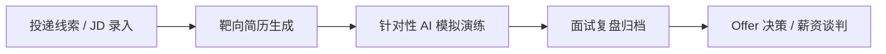
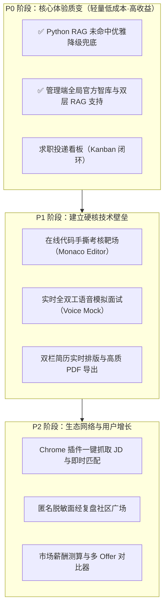

# MindForge AI 产品演进路线图与功能扩展规划全景

> **版本**：v1.0.0-draft  
> **更新时间**：2026-10-12  
> **状态**：待评审与分期规划备忘录  
> **归属工程**：`mindforge-ai`（Java 后端）/ `mindforge-ai-service`（Python AI 中枢）/ `mindforge-web`（前端）

---

## 目录
1. [一、 核心链路突破：把“模拟”做到极致逼真（核心竞争力）](#一-核心链路突破把模拟做到极致逼真核心竞争力)
2. [二、 求职全生命周期管理闭环（大幅提升用户留存）](#二-求职全生命周期管理闭环大幅提升用户留存)
3. [三、 内容与数据生态：从“纯工具”迈向“知识沉淀”](#三-内容与数据生态从纯工具迈向知识沉淀)
4. [四、 跨端提效与引流工具（获客与黏性抓手）](#四-跨端提效与引流工具获客与黏性抓手)
5. [五、 最新讨论专题：双层 RAG 架构与检索降级兜底优化](#五-最新讨论专题双层-rag-架构与检索降级兜底优化)
6. [六、 建议分期落地规划（按投入产出比推荐）](#六-建议分期落地规划按投入产出比推荐)

---

## 一、 核心链路突破：把“模拟”做到极致逼真（核心竞争力）

| 模块名称 | 解决痛点（业务价值） | 行业成熟对标 | MindForge 落地建议 |
| :--- | :--- | :--- | :--- |
| **1. 实时全双工语音模拟面试（Voice Mock）** | 目前文字输入打字速度慢，真实面试均为口头临场表达（常出现口误、结巴、逻辑停顿）。单纯打字无法训练心理抗压能力与语速节奏。 | *Interviewing.io*、*牛客 AI 模拟面*、*GPT-4o 语音模式* | • 前端通过 Web Audio API / WebSocket 采集麦克风流； • 后端 Python 接 SenseVoice / Whisper 做毫秒级流式 ASR； • AI 面试官输出调用 Edge-TTS / CosyVoice 流式发音； • 面试报告增加**语速统计、停顿卡顿频率、口头禅高频词统计**。 |
| **2. 白板协同手撕代码靶场（Live Code Playground）** | 70% 的技术面都会考核手撕算法与核心架构代码。单纯纯文本无法评估候选人的编码规范、边界处理与实际编译执行结果。 | *LeetCode 白板*、*CoderPad*、*牛客代码面* | • 前端集成 `Monaco Editor`（VS Code 核心编辑器）； • 接入沙箱执行器或内置轻量 JS/Python/Java 代码执行环境； • AI 面试官实时“观察”候选人编写过程，针对**边界条件、时间/空间复杂度**实时追问打分。 |
| **3. 针对目标 JD 的“靶向简历生成与 ATS 跑分”（Tailored Resume Generator）** | 用户往往一份通用简历海投，与特定 JD 匹配度低；主流招聘系统均采用 ATS 自动初筛，关键字匹配低容易直接被刷。 | *Resume.io*、*Jobscan*、*职徒简历* | • 用户选择已有简历 A + 目标职位 B，AI 自动提炼 JD 关键词差距（Keyword Gap）； • **一键自动重构项目经历**（严格基于 STAR 法则扩充量化业务数据）； • 支持在线双栏实时排版编辑，并直接一键导出符合大厂招聘系统的优雅高清 PDF。 |

---

## 二、 求职全生命周期管理闭环（大幅提升用户留存）

很多同类平台仅作为单次练习工具，练习后用户即流失。将 MindForge 升级为求职者的**每日求职工作台（求职 CRM）**，实现全链路留存：

### 4. 求职投递看板（Job Application Kanban / 求职 CRM）
* **功能设计**：
  * 类似 Trello / Notion 的多列拖拽看板：`待投递 ➔ 已投递 ➔ 简历初筛 ➔ 技术一面 ➔ 技术二面 ➔ HR面 ➔ 已拿Offer ➔ 已归档`；
  * 每个卡片可**一键绑定**该岗位的 JD、生成的定制简历、以及在 MindForge 里进行过的模拟面试记录与复盘报告；
  * **面试日历提醒**：日历视图标明各家公司的笔试与面试时间节点。

### 5. 市场薪酬测算与 Offer 对比器（Salary Benchmark & Offer Decider）
* **功能设计**：
  * 基于用户的简历年限、技术栈评级、目标城市以及模拟面试的能力雷达图，估算该岗位的**市场分位薪资区间（P50/P75/P90）**；
  * 当用户拿到多家 Offer 时，提供“五维综合决策打分表”（薪资包、技术栈发展、平台背书、加班强度、通勤距离）。

---

## 三、 内容与数据生态：从“纯工具”迈向“知识沉淀”

打破用户单打独斗与无资料可用的僵局，构建平台级知识飞轮：

### 6. 官方大厂高频真题题库与考点雷达（Curated Question Bank）
* **功能设计**：
  * 内置精选分类公共题库（如：Java 并发编程、MySQL 调优、Redis 核心场景、前端工程化、微服务架构、HR 行为面必问宝典）；
  * **大厂考点命中预测**：分析目标公司（如美团、阿里、字节）近三个月的真实面经，标注哪些题属于“超高频必考”；
  * **艾宾浩斯记忆遗忘曲线复习**：对错题与面试被扣分的问题，自动安排在第 1、3、7 天推送快速复习。

### 7. 匿名面经复盘广场（Anonymous Review Community）
* **功能设计**：
  * 用户做完模拟面试后，支持一键**脱敏发布**到“面经广场”；
  * 其他求职者可以在广场浏览别人是如何回答刁钻追问的、AI 面试官给出的标准参考答案是什么，互相点赞、评论与收藏。

---

## 四、 跨端提效与引流工具（获客与黏性抓手）

### 8. Chrome 浏览器插件（MindForge Clipper）
* **功能设计**：
  * 用户在 Boss直聘、拉勾、牛客、智联等网站浏览职位时，点击插件侧边栏：
    1. **一键抓取 JD**：自动抓取当前岗位详情并同步到 MindForge 工作台；
    2. **即时匹配度评分**：直接在招聘网站当前页面浮窗展示“你的简历匹配度为 82%，核心缺少：Flink/大模型实战经验”；
    3. **一键生成面试押题**：直接给求职者列出面试官最可能提问的 3 个核心方向。

---

## 五、 最新讨论专题：双层 RAG 架构与检索降级兜底优化

针对当前前后端架构的实际瓶颈，最新探讨的两大关键落地方案：

### 9. 管理端全局官方知识库与双层 RAG 架构（Dual-Tier RAG Architecture） ✅ 已实现
* **背景与痛点**：
  * 当前仅允许用户在个人端创建知识库并上传文档；新用户注册后知识库为空，形成“冷启动壁垒”；
  * 大模型知识停留在预训练截止期，而各大厂最新面试考点、最新招聘标准周更/月更，大模型无法即时跟进。
* **业务与架构设计**：
  * **管理端后台功能新增**：提供管理员专属的官方知识库上传与维护通道，支持上传《2026各大厂最新真题集》、《行业标准高分项目经历库》、《标杆岗位能力图谱》等；
  * **数据模型分层**：
    * `GLOBAL`（公域官方库，`is_system=1`）：管理员维护，全站只读共享，为全平台用户提供基座知识；
    * `USER`（私域个人库，`user_id=xxx`）：用户自己维护，严格租户级隔离，杜绝隐私泄漏；
  * **双路并行召回与重排（Dual-Retrieval & Rerank）**：
    * 检索时并行从“官方公域库”与“个人私域库”各自拉取高相关候选（Chroma `$in` 多库联合过滤）；
    * 经 Rerank 精排后联合注入对话上下文；
    * 赋能范围不仅限于日常问答，更深度注入到“简历润色（行业标杆对照）”与“模拟面试出题（大厂高频真题与考核标准注入）”中。

### 10. Python 后端 RAG 未命中时的通用模型优雅降级（Graceful Fallback） ✅ 已实现
* **背景与痛点**：
  * 目前 `app/services/chat.py` 中，当未检索到相关内容时，直接阻断并不调用大模型，生硬返回固定文案：
    > `“提供的资料中没有找到相关内容。请尝试换个说法，或者确认相关内容是否已上传到该知识库。”`
  * 用户即使输入普通的寒暄、打招呼或未被文档包含的通用技术问题，也会吃到冰冷的“闭门羹”，体验僵硬。
* **优化策略（明确标识 + 通用模型兜底解答）**：
  * 检索未命中知识库时，**绝不直接拒答**，而是组装带免责声明的通用 Prompt 降级调用通用模型；
  * 模型友好回答：
    > `“💡 在您的知识库中未检索到与该问题直接相关的资料。以下基于 MindForge AI 通用专业模型为您解答：……”`
  * 响应事件中传递 `hasContext: false`，`hasAnswer: true`；前端友好展示灰色胶囊提示（`🤖 通用模型生成` 代替绿色的 `📚 知识库溯源`）。

---

## 六、 建议分期落地规划（按投入产出比推荐）

---

## 七、 基础设施与私有化存储演进（MinIO / S3 兼容）

| 演进项 | 现状与痛点 | 改造方案与优势 | 落地计划 |
| :--- | :--- | :--- | :--- |
| **MinIO 本地私有化对象存储集成** | 当前支持 `LOCAL`（本地文件目录）与 `ALIYUN_OSS`（阿里云 OSS）。公网 OSS 上传/下载受外网带宽影响，存在网络延迟与公网出流量费用，且求职者简历等敏感数据存储在公有云存在合规考量。 | • 引入 **MinIO**（轻量级分布式对象存储，100% 兼容 AWS S3 API）； • 支持本地开发或企业内网通过 Docker Compose 一键拉起； • **性能优势**：局域网千兆/万兆内网传输，大幅减少公网 HTTP 握手与大文件传输时延； • **平滑迁移**：Java 存储层已抽象 `FileStorageService` 接口，仅需扩展 `MinioFileStorageServiceImpl`（基于 AWS S3 Java SDK v2），预签名 URL 与前端直传逻辑无缝复用。 | 待集成备选（可通过 Docker 快速替换） |

---
*注：本文档已固化保存，作为后续系统功能升级、技术方案评审与版本迭代的核心基线依据。*
